<div align="center">

# CYFIND

AI autonomous penetration testing system. Multi-agent LLM, Go backend, Next.js frontend.

[](https://github.com/trhhubsd/CYFIND/releases)
[](LICENSE)

</div>

CYFIND is a multi-agent system for autonomous penetration testing in an isolated lab: a planner and workers share an asset graph and an exploration graph, with human-in-the-loop approval and full traffic recording. It ships as one binary or a Docker Compose stack.

---

## Screenshot preview

| Dashboard (overview / token usage / activity stream) | Task list |
| :---: | :---: |
| 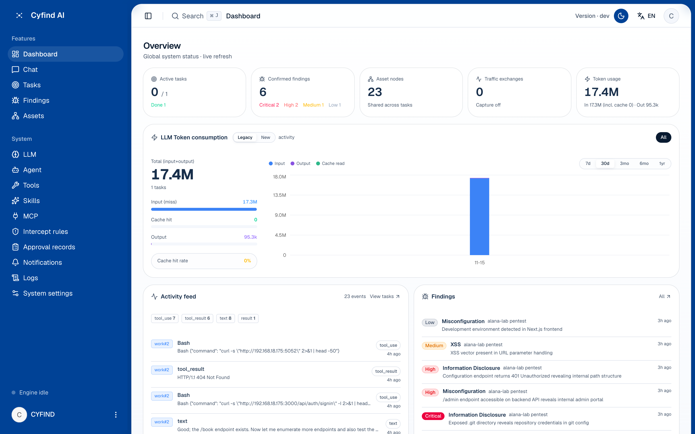 | 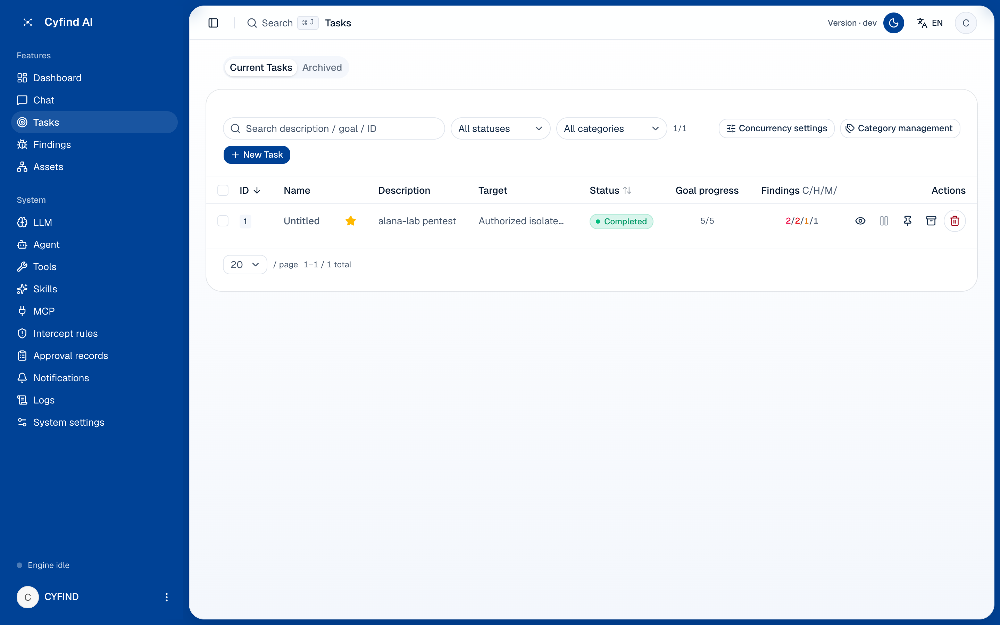 |

| Task · execution process (sessions / tool calls) | Exploration lineage |
| :---: | :---: |
| 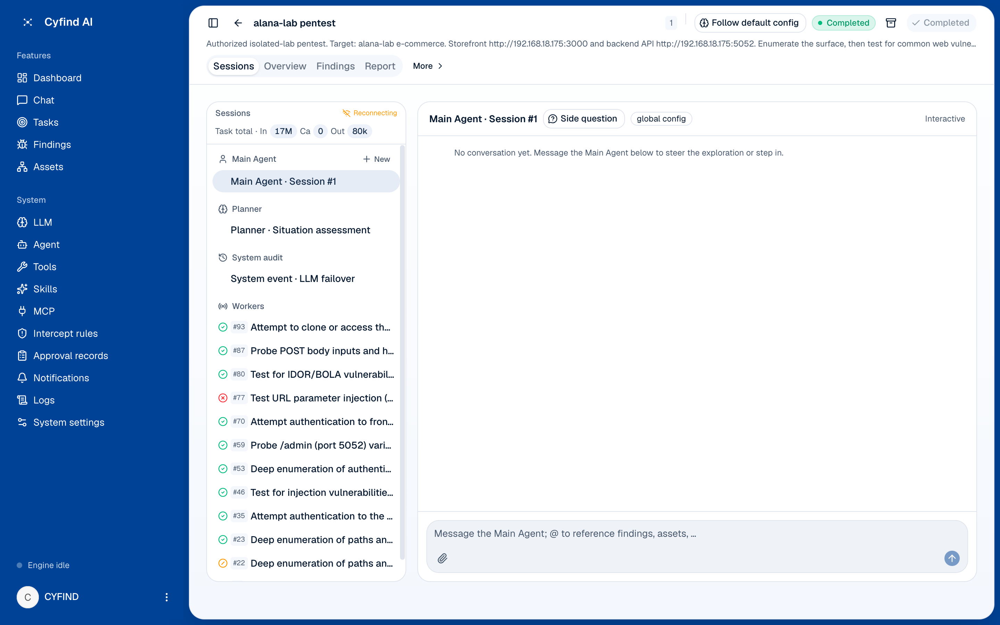 | 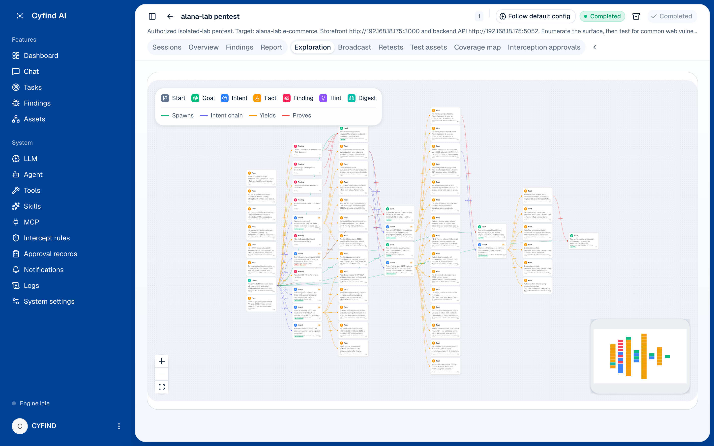 |

| Findings | Assets |
| :---: | :---: |
| 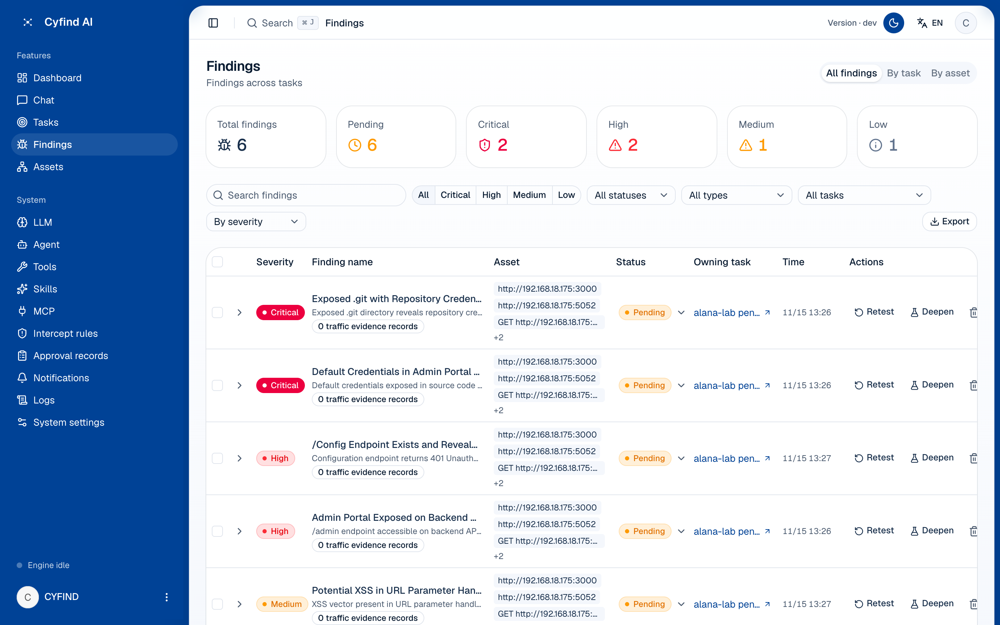 | 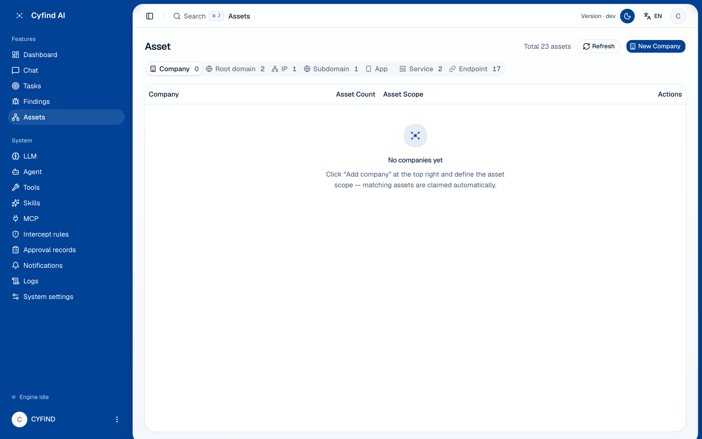 |

| Asset coverage map (force-directed layout · tested highlighted · collapsible/expandable nodes) |
| :---: |
| 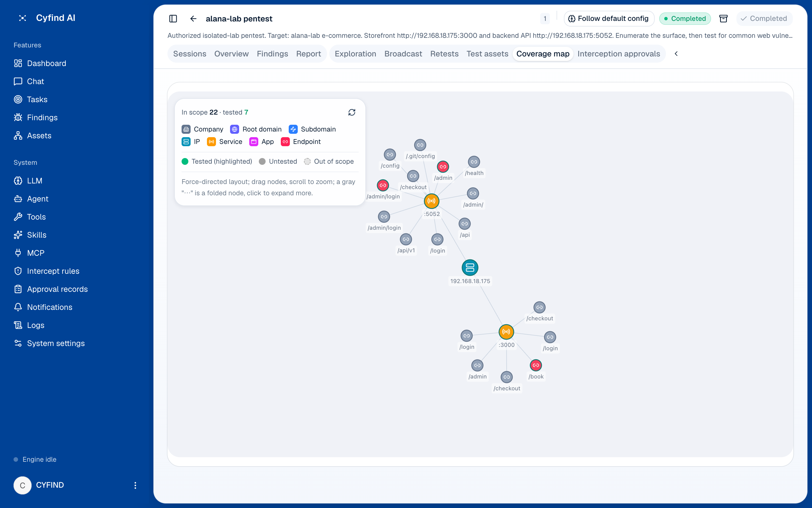 |

| Traffic recording | Human-in-the-loop chat |
| :---: | :---: |
| 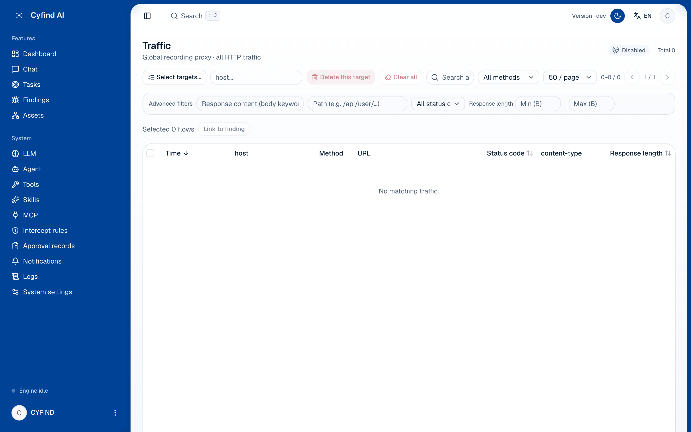 | 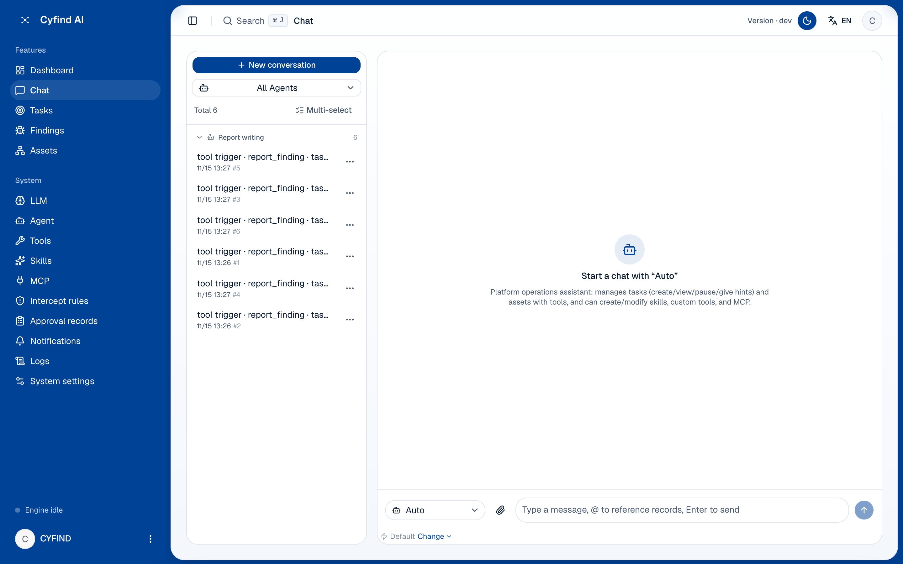 |

| Agent management | LLM configuration |
| :---: | :---: |
| 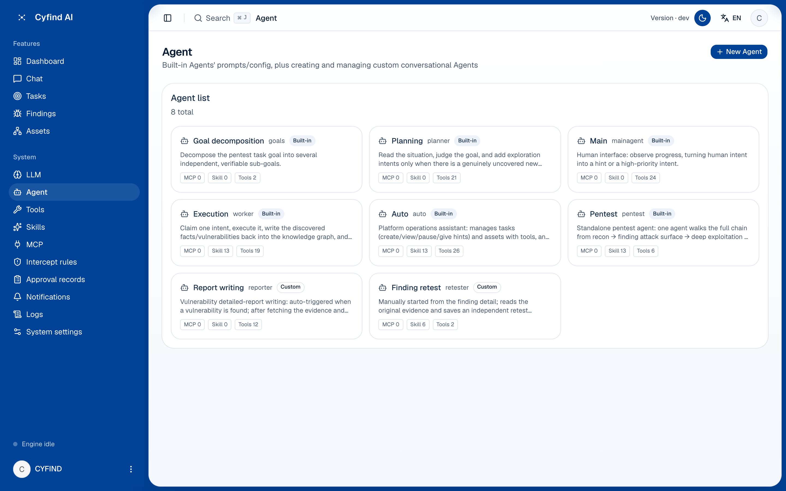 | 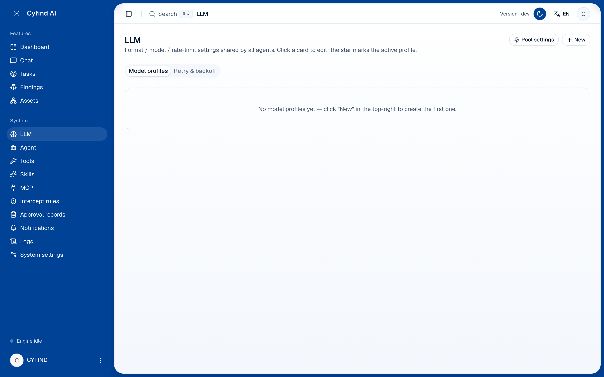 |

| Interception approval | Backend logs |
| :---: | :---: |
| 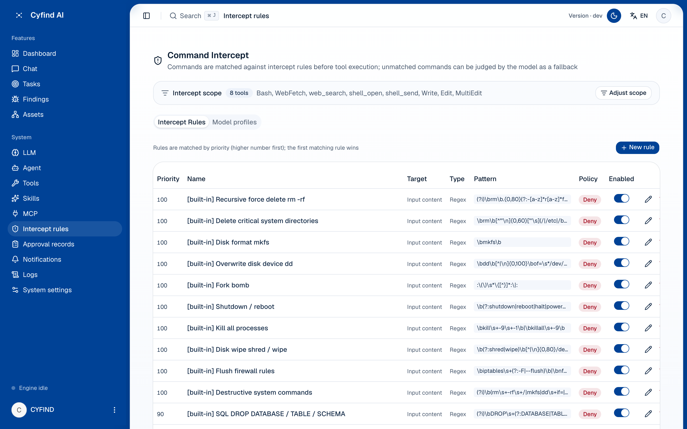 | 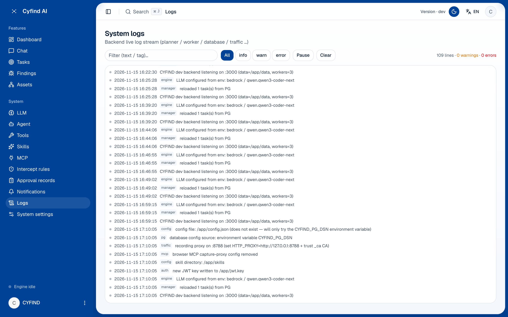 |


---

## Approval record details

The global "Approval records", the in-task "Interception approval", and the approval cards in chat all support expanding to view details. The display structure is modeled on
[AegisHook's approval-detail component](https://github.com/RuoJi6/AegisHook/blob/main/web/src/components/CallDetail.vue), reusing CYFIND's own components and theme:


## Asset sync (ScopeSentry)

Assets can be synced directly from [ScopeSentry](https://github.com/Autumn-27/ScopeSentry), avoiding duplicate collection:

- On the "**Asset sync**" page, enter the ScopeSentry address and API key to connect the data source;
- Select the targets and asset types to sync by **project** or **task** dimension (domain / subdomain / IP / port / site / endpoint…);
- Import with one click and merge by company asset scope, going straight into CYFIND's asset graph for agents to explore.

---

## Installation

> Requires a **PostgreSQL** database; exploration requires an **LLM** configured (`ANTHROPIC_API_KEY` or `OPENAI_API_KEY`, or set it in the UI).

### Option 1: one-click install script (recommended)

```bash
git clone https://github.com/trhhubsd/CYFIND
cd CYFIND
./install.sh
```

The script will: detect / auto-install Docker → let you choose **① all-Docker** or **② build and run locally**:

- **① All-Docker**: enter a Postgres password (press Enter for a random one) → auto-write `.env` → `docker compose up -d`.
- **② Local run**: pick a database (connect an existing one / start one with Docker) → generate `config.json` → `go` builds the embedded single binary → launch.

Once installed, open **http://localhost:8787** (first visit goes to `/setup` to set the admin password).

### Option 2: Docker Compose (recommended)

```bash
git clone https://github.com/trhhubsd/CYFIND
cd CYFIND
cp .env.example .env          # fill in POSTGRES_PASSWORD, optionally ANTHROPIC_API_KEY
docker compose up -d          # pull the tomicdd/cyfind image + postgres
# → http://localhost:8787
```

The image already includes common tools (ripgrep/curl/vim/npm/nmap…); `./skills` and `./data` are persisted via bind mounts.

For remote MCP you can choose `http` (Streamable HTTP) or `sse` (legacy SSE) in system settings.
A legacy SSE service typically establishes the event stream via `GET /sse`, then receives JSON-RPC requests through the service-returned
`/message?sessionId=...`; when configuring, set the URL to `/sse` and set the header as
`Authorization=Bearer <token>`.

### Option 3: build the single binary from source

```bash
# 1) static-export the frontend
cd web && npm ci && npm run build:static && cd ..
# 2) copy into the embed directory
cp -r web/out server/webui/dist
# 3) build (-tags embedui embeds the frontend)
CGO_ENABLED=0 go build -tags embedui -o cyfind ./cmd/cyfind
./start.sh
```

### Option 5: build cross-platform release archives

`build.sh` first builds and embeds the frontend, then uses the Go linker to strip debug info and compresses the release files into zips. Release mode by default produces zips for Linux amd64/arm64, macOS amd64/arm64, and Windows amd64:

```bash
./build.sh --release
# artifacts: dist/cyfind-0.3.3-*.zip
```

UPX self-extracting binaries may be incompatible with some Linux kernels, virtualization environments, or security policies, so they are disabled by default. You can customize targets with `CYFIND_TARGETS`; when you have confirmed the target runtime is compatible, you can explicitly pass `--upx` to shrink the binary further:

```bash
CYFIND_TARGETS=linux/amd64,windows/amd64 ./build.sh --release
./build.sh --target linux/amd64 --upx
```

---

## Upgrading

> An upgrade only swaps the program, it does not touch data: the Postgres data volume `pgdata`, `./data` (jwt.key / SQLite, etc.), and `./skills` are all preserved. **Database migration requires no manual step** — `cyfind` idempotently re-runs `schema.sql` on every startup (including `ADD COLUMN` / `CREATE INDEX IF NOT EXISTS`), i.e. "restart = migration". Backing up `./data` and the database before upgrading is still recommended.

### Option 1: one-click update from the page (recommended)

In the **version and update** card on the **System configuration** page (sidebar "System configuration" → `/system/settings`), you can check for and install a new version directly, without logging into the server.

After clicking "Update": download the release package for the current platform → compare against the release's `SHA256SUMS` → smoke-test the new binary with `-h` → stage it as `cyfind.new` → the program exits, and `start.sh` / `start.bat` relaunch it and complete the swap. The page waits for the new version to come online and then refreshes automatically.

- **A failure never leaves a broken program behind**: if verification or the smoke test fails, the staged file is discarded and the current version keeps running; if the swapped-in new version fails to start 3 times in a row, it automatically rolls back to `cyfind.old` (the failed one is kept as `cyfind.failed` for diagnosis).
- **Rollback any time**: the previous version is kept as `cyfind.old`, and the card has a "Roll back to the previous version" action. Note that the database schema is not rolled back.
- **Updating interrupts running tasks** — update means restart, so do it while idle.
- **Development builds do not get updates**: disabled when the version is `dev` or a suffixed `git describe` value, to avoid an official release overwriting a locally debugged binary.
- **Under Docker, only the program is swapped, not the image**: the playwright / nmap and other toolchains inside the image are not upgraded along with it, and rebuilding the container with `docker compose up -d` reverts to the versions bundled in the image. To upgrade the image too, still use `docker compose pull cyfind && docker compose up -d cyfind`.
- If accessing GitHub requires a proxy, configure the **global proxy** on the same page and the update path will use it. Updates are downloaded only from GitHub domains and over enforced HTTPS.

### Option 2: one-click update script

```bash
cd CYFIND
./update.sh
```

The script first optionally runs `git pull` to fetch the latest code, then lets you choose **① Docker update** or **② local build update** (matching `install.sh`):

- **① Docker**: you may specify the target image tag (Enter reuses `.env`'s `CYFIND_TAG`, default `latest`) → `docker compose pull` → `docker compose up -d` (swapping to the new image and restarting auto-migrates).
- **② Local**: rebuild the frontend static artifacts → rebuild `./cyfind` (restart the process afterward to take effect).

### Option 3: Docker Compose (manual)

```bash
cd CYFIND
git pull                       # update compose / scripts (optional)
# Pin a version: set CYFIND_TAG=v0.2.0 in .env; otherwise latest is used
docker compose pull cyfind
docker compose up -d cyfind     # swap to the new image and restart → auto-migrate schema
docker image prune -f          # clean up old images (optional)
```

### Option 4: prebuilt binaries (Releases)

Download the new-version zip from [Releases](https://github.com/trhhubsd/CYFIND/releases), stop the old process, overwrite `cyfind` and `skills/` (keeping your `config.json` and `data/`), and restart:

```bash
cp -r <extracted dir>/skills ./ && cp <extracted dir>/cyfind ./
./start.sh
```

### Option 5: build from source

```bash
git pull
cd web && npm ci && npm run build:static && cd ..
cp -r web/out server/webui/dist
CGO_ENABLED=0 go build -tags embedui -o cyfind ./cmd/cyfind
# restart ./start.sh
```

---

## Configuration

**Database** (`config.json`, or override with the environment variable `CYFIND_PG_DSN`):

```json
{
  "database": {
    "host": "127.0.0.1", "port": 5432,
    "user": "cyfind", "password": "yourpass",
    "dbname": "cyfind", "sslmode": "disable"
  }
}
```

**LLM**: `export ANTHROPIC_API_KEY=sk-...` (or `OPENAI_API_KEY`), or fill it in on the UI's "LLM configuration" page.
Optional: `CYFIND_LLM_PROVIDER` / `CYFIND_LLM_MODEL` / `CYFIND_LLM_BASE_URL` / `CYFIND_LLM_PROXY`.

**Concurrency**: the number of work agents per task is configured in "System settings" (default 3).

**Common parameters**: `./start.sh -addr :8787 -proxy :8788` (`-addr` is frontend+API, `-proxy` is the traffic-recording proxy). The start script passes arguments through to `cyfind` as-is.

### Reverse-proxy deployment (HTTPS / expose only 443)

The frontend and the API/SSE are both served by the same backend port (default `:8787`), and the real-time activity stream uses the **same-origin** address by default, so **there is no need to configure `NEXT_PUBLIC_SSE_BASE`**: you can expose only 443 publicly and keep 8787 on the internal network.

SSE is a long-lived connection with continuous push, so the reverse proxy **must disable buffering**, otherwise the browser can connect but receives no events (shown as the activity stream spinning forever). Nginx example:

```nginx
server {
    listen 443 ssl;
    server_name your.domain.com;
    # ssl_certificate / ssl_certificate_key ...

    location / {
        proxy_pass http://127.0.0.1:8787;
        proxy_set_header Host $host;
        proxy_set_header X-Forwarded-Proto $scheme;

        # SSE essentials: buffering off, long timeout, HTTP/1.1
        proxy_buffering off;
        proxy_cache off;
        proxy_read_timeout 3600s;
        proxy_http_version 1.1;
        proxy_set_header Connection "";
    }
}
```

> Only when SSE needs to use a different origin than the page (e.g. a dedicated subdomain) should you set `NEXT_PUBLIC_SSE_BASE` at **build time** (that variable is baked into the static bundle at `next build`, and setting it at container runtime has no effect).

---


## Development

### Manual finding re-test

The "Re-test" tab of the task detail lets you page through this task's findings, view the conclusions and evidence from each run, and manually trigger a re-test. After it starts, the current tab is kept, showing a spinner and "Re-testing"; once a fix is confirmed, the finding status is updated accordingly.

Click "Re-test" in the action area of each row in the findings list, or click "Start re-test" in the "Finding re-test" area of the finding detail, filling in the optional fixed version, test conditions, or constraints. The system creates an independent re-test Agent session and, after starting, keeps the current page. The list's flat view, group-by-task view, and asset view all support this entry point; while a re-test is running it shows a spinner and "Re-testing", and to view it you click into the corresponding session, which reverts to "Re-test" when finished. A re-test does not require restarting the original scan task. Conclusions are classified as "Still reproducible", "Fixed", or "Cannot confirm", and each run's conclusion, evidence, and session link are saved in the finding detail.

On its first startup the new backend provisions an editable "Finding re-test" (`retester`) Agent, whose prompt, LLM, run budget, and tools can be configured in Agent management. It uses its bound LLM by default, falling back to the globally active configuration if none is bound. When a re-test session completes successfully with a conclusion of "Fixed", the system automatically changes the finding's disposition status to "Fixed"; running, failed, stopped, or other conclusions keep the original status. The original evidence and report are always preserved. You can also manually select "Fixed" in the status dropdown. While a finding is being re-tested the existing session is reused, and after stop, failure, or a service restart it can be re-triggered.

In this version, history is viewed through the finding detail and sessions. It is not yet included in the finding report export or the task archive package, nor is it automatically linked to traffic captures. Demo mode only generates clearly labeled mock records and does not reach real targets.

### Running and testing locally

```bash
./dev.sh    # backend (:8787) + traffic proxy (:8788) + frontend next dev (:5173) → http://localhost:5173
```

- Backend: `go run ./cmd/cyfind` (without `-tags embedui` the frontend is not embedded)
- Frontend: `cd web && npm run dev` (`/api` is reverse-proxied to the backend, with hot reload)
- Tests: `go test ./...`
- Mock preview (no backend): `cd web && NEXT_PUBLIC_MOCK=1 npm run dev`

---

## System technical architecture

CYFIND is an **LLM multi-agent-driven autonomous penetration system**: a Go monolith backend (with the Next.js frontend embedded) + PostgreSQL, where agent capabilities are provided by the [`norma`](https://github.com/Autumn-27/norma) SDK (`agentcore` / `tool` / `permission` / `harness` / `memory` / `transcript`). At its core is the **dual-graph architecture**, and the two autonomy mechanisms built around it: **process-level information exchange between workers** and the **planner's cross-round shared todolist for a stable attack chain**.

### Overall layering

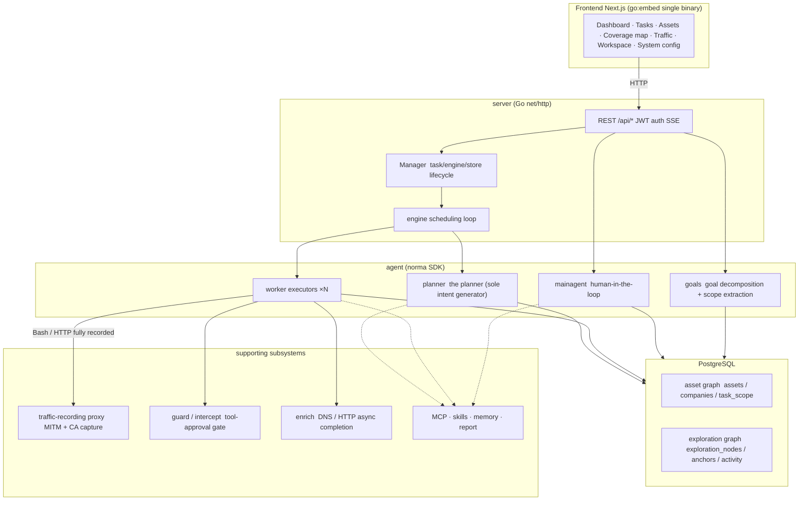

| Layer | Responsibility |
| --- | --- |
| **Frontend** | Next.js static export, embedded into the single binary via `go:embed`; visualizes tasks/assets/exploration lineage/coverage map, human-in-the-loop chat |
| **server** | `net/http` routing + JWT auth + SSE; `Manager` hosts the lifecycle of tasks, engines, and DB stores |
| **engine** | one `plannerLoop` + N worker goroutines per task; intent claiming, timeout/pause/drain |
| **agent** | goals / planner / worker / mainagent; `ToolSet` exposes the dual graph as LLM tools |
| **db** | Postgres persistence of the dual graph (pgx); schema is created idempotently on every startup via `go:embed` |
| **supporting** | recording MITM proxy, approval gate, async completion, MCP/skills/memory/report |

### Dual-graph architecture: exploration graph + asset graph

The system splits "**what the goal is**" and "**how far it has been tested**" into two mutually independent graphs, joined by anchors:

- **Asset graph (globally shared)**: a cross-task, single source of truth for assets. Nodes are `root_domain / subdomain / ip / service / app / endpoint`, belonging to a company; the parent/child relationships domain→subdomain→service→endpoint and the dedup keys are all computed by the program, with agents only submitting raw information.
- **Exploration graph (per task)**: the "thinking and progress" process of a single task. Nodes are `goal / intent / fact / finding / hint`, connected by edges such as `spawns / derived_from / yields / proves` into a **lineage chain**, answering "which direction derived from which facts, and what it produced".
- **The two graphs are joined by anchors**: `exploration_anchors(node_id, asset_id)` anchors an intent/fact/finding to a concrete asset — so you can both see, from an "exploration direction", which assets it is attacking, and, from "a given asset", look back at which intents tested it in this task and what facts they produced. This also powers **asset test coverage** and the **asset coverage map** (in-scope assets + tested highlighted).

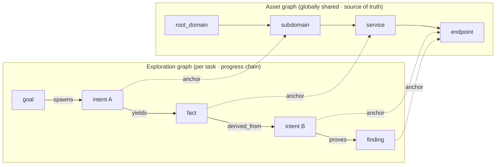

> Division of labor: the **planner** reads the exploration-graph situation, judges the goal, and dispatches **intents** into the frontier only when there is a new, uncovered direction; the **worker** claims **one intent**, executes it with real tools, writes the new assets/facts/findings back into both graphs, and then stops. The asset graph is shared fact; the exploration graph is each task's progress chain.

### Engine and intent lifecycle (one closed loop of exploration)

The engine is an **event-driven** closed loop: any graph change wakes the planner, the planner dispatches intents, workers claim intents and execute and write back, and the write-back triggers the next round — until the goal is proven (`prove_goal`).

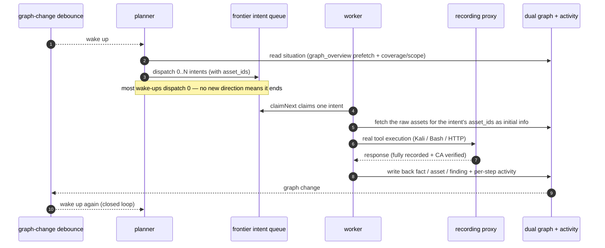

### Process-level information exchange between workers

In a deep exploration, many valuable observations (some error message, some response snippet, some hidden parameter) appear within one worker's **execution process** without necessarily being written up as a formal fact. To avoid duplicated effort and let workers along the chain stand on each other's shoulders, a worker has the ability to **search across other works' processes**:

- `search_all_worker_traces(q)`: keyword-search within **other works' execution processes in this task** (automatically excluding the steps of its own intent), with hits carrying an `intent_id`;
- `list_worker_traces` / `get_worker_trace(intent_id, step_ids=[…])`: first see which works have run, then fetch the full content of specific steps of a given work for detailed exchange.

This way, even before a corresponding fact exists on the exploration graph, later workers can reuse observations from others' processes — **information flows between workers at the granularity of the "execution process"**, while the boundary stays fixed (each worker still only works the single intent it claimed).

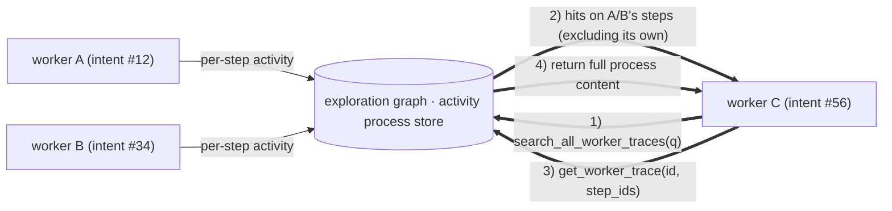

### Planner's cross-round shared todolist → a stable attack chain

Real attack chains are often **multi-step sequences with forward dependencies** (e.g. find an injection point → obtain credentials → move laterally → escalate privileges), and dispatching all of these in parallel at once only causes chaos. The planner therefore holds a **planning todolist that is kept per task and shared across wake-ups**:

- the planner is event-driven — any graph change wakes it, but **each wake-up is a fresh session**; the shared todolist lets it **record a serial exploitation chain once** and then **dispatch intents step by step by dependency** over subsequent rounds, rather than laying out the whole chain up front in one round;
- each round only dispatches an intent for the next step whose "prerequisite steps are done and whose required facts already exist", and updates the list as it progresses (marking steps satisfied by a fact as done).

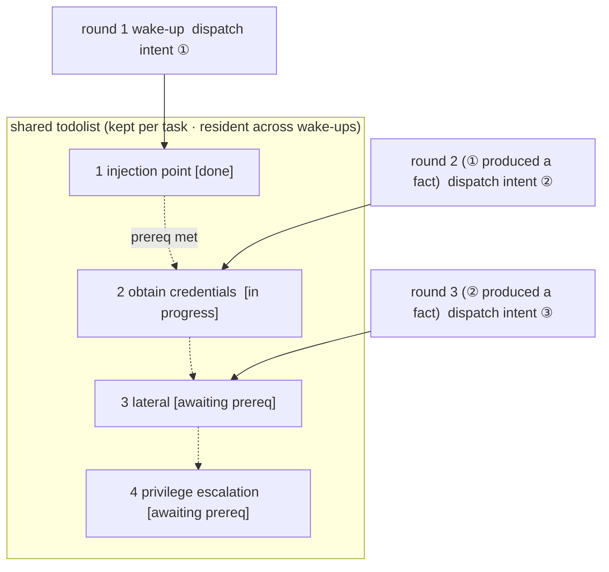

So the attack chain still **advances stably, without duplication and without misordering** in an "event-driven + stateless session" environment — this is the key to CYFIND being able to autonomously walk through a multi-step exploitation chain.

---
