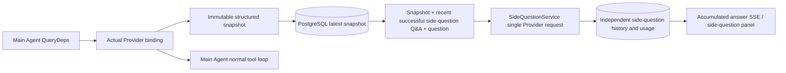

# CYFIND `/btw`

Regular chat, the task MainAgent, and the current task's own Worker all support an independent side-question. Type `/btw <question>` in the main input box to submit; an empty `/btw` or the "Side question" button opens the history. On desktop a resizable side panel is used; on mobile a Drawer is used.

A side-question answer is generated from the Agent context snapshot taken at submission time, and supports streaming display, follow-up questions, stop, and clear. Closing the panel, refreshing the page, or disconnecting SSE does not cancel the model request. Stop only affects the current side-question; clear cancels the side-question and deletes the side-question history while preserving the main context snapshot.

## Implementation boundaries

This reuses Go, norma v0.3.7, Next.js, and the existing Markdown / ResizablePanel / Drawer / AlertDialog components; it does not modify norma's source or add dependencies for the side-question. The Planner, Workers inherited from other tasks, and tool-type subtask promotion are out of scope for this round.

- `capture.go` marks a main-loop request only on `Options.Deps.CallModel / CallModelSync`. The Provider decorator sits inside the concrete model, after the routing pool's outer selection, so it records the actually-selected model; compaction and summary requests do not overwrite the snapshot.
- The snapshot is published at request start, at the complete model reply, and at the run terminal state. An in-progress half reply is not published; tool calls stay paired via norma's `MessagesForAPI`, and tool results enter the snapshot on the next main-model request or at the run terminal state. A streaming abort keeps the last valid boundary.
- The snapshot preserves structured messages, the system prompt, tool definitions, and generation parameters via a JSON deep copy. Model inference does not hold the snapshot lock or a database transaction.
- `SideQuestionService` calls the concrete Provider; when necessary it first generates a side-question summary, and the final answer is only allowed to be reduced and retried once, on the first context-overflow when no text/tool-call has been output yet. It does not create an agent session, and does not connect to the tool executor, the main transcript, the activity stream, or the task graph, nor does it go through the task's model-switching chain. The answer keeps tool definitions for compatibility with the existing structured tool context; the summary request provides no tools. Newly returned tool calls have no execution path.
- One running request per parent session, at most four per service process, with a 120-second timeout each. The side-question uses an independent cancellation context under the service lifecycle.
- A side-question request keeps a model-config reference and a non-sensitive identity summary; credentials are obtained from the existing config at request time. If the config is deleted, or identity fields such as the model, protocol, or address change, the main Agent must be run first to update the snapshot. Tests do not change the product's default model.

## Persistence and recovery

`db/schema.sql` automatically creates `side_question_sessions` and `side_question_requests`. The former stores the parent resource, the latest snapshot, the run number, the version, and the clear version; the latter stores the question, the accumulated answer, the status, the model, the snapshot time, usage, the event sequence number, and the paging sequence number.

The parent session key uses the conversation ID, or the task ID + exploration ID + intent ID. Workers do not use a reusable execution-slot naming.

The snapshot is merged and written per parent session, flushed every 250 ms, with the database comparing `(run_id, version)` to prevent an older version from overwriting. The selected snapshot is saved again before the side-question is submitted. After a successful save the large in-memory snapshot is released; on failure the pending version is kept. The answer's accumulated content is written at most every 250 ms as streaming events arrive, and the terminal state is saved immediately with limited retries on a database error.

On service startup, leftover `running` requests are marked `interrupted`, keeping the partial answer and usage already persisted, and the request is not automatically replayed. The most recently successfully saved context can be used directly for the next question. When an old session has no snapshot, the main Agent must be run first; the context is not reconstructed from UI activity records.

The clear operation increments the clear version and deletes requests; a conditional update blocks a late callback from writing back again. Physical parent-resource deletion relies on foreign-key cascade; a Worker logical delete deletes the side-question data in the same transaction and rejects subsequent late snapshots. Task archiving first blocks new requests, waits for the main flow to stop, and cancels and waits for the side-question to persist; the archive format is v3, while remaining compatible with v1/v2 that have no side-question tables.

The history is fully preserved, returning at most 20 items per page by an ordinal cursor. A model request replays at most the most recent 20 groups of successful Q&A verbatim, while also limiting the replay amount by a token budget; older Q&A maintain an independent rolling summary. When the main context exceeds budget, only the older part of the side-question's copy is summarized, keeping recent structured tool calls and results. The summary, preparation progress, and usage are all subject to the side-question's concurrency, cancellation, and 120-second timeout limits. See [Context budget and open-source references](CONTEXT_BUDGET.md) for details.

## HTTP contract

The following paths serve as `{parent}`, reusing the existing authentication and resource validation:

- `/api/conversations/{id}`
- `/api/tasks/{id}/chat`
- `/api/tasks/{id}/intents/{iid}`

| Request | Response and behavior |
| --- | --- |
| `GET {parent}/side-questions?before={ordinal}` | `items` ordered newest-to-oldest, an independent `current` run status, `snapshot` metadata, and `next_cursor`; a cursor of 0 means the latest page / no next page |
| `POST {parent}/side-questions` | JSON `{ "question": "…", "client_request_id": "UUID" }`; a new request returns 202 with the request object; the same ID and question returns the existing object with 200 |
| `DELETE {parent}/side-questions` | cancels and clears the current parent session's side-question Q&A |
| `GET /api/side-questions/{requestID}/events` | `snapshot` SSE event, with `id` an incrementing sequence number and `data` the complete accumulated request object; sends `cleared` on clear |
| `POST /api/side-questions/{requestID}/cancel` | explicit cancel; the terminal state can be read from history or SSE |

The question limit is 4000 characters. No snapshot, a changed model config, a busy parent session, or an idempotency-ID conflict returns 409; the global concurrency limit returns 429. Every SSE connection first sends the accumulated state and does not depend on text fragments the client received before. The frontend merges by request ID + sequence number, and discards stale callbacks when switching parent session or on clear.

## Validation and references

Automated checks, actual model usage, and known limitations are in [VALIDATION.md](VALIDATION.md).

For the independent request, see [Grok CLI side-question.ts (pinned commit)](https://github.com/superagent-ai/grok-cli/blob/fb97af83f06dca873281d60168430f06c8de6324/src/utils/side-question.ts); for run isolation, see [OpenCode (pinned commit)](https://github.com/anomalyco/opencode/tree/b3f1a96c6dd7adeb28b36dd11add1998fc84d67b). CYFIND's context uses norma's structured messages, rather than stitching text together from frontend logs.
