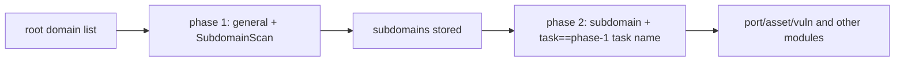

---

## name: scopesentry-mcp
description: Manage a security scanning platform (projects, tasks, templates, assets, nodes) via the ScopeSentry MCP. Use it when the user mentions ScopeSentry, MCP, API Key, scan tasks, or asset queries.

# ScopeSentry MCP usage guide

Aimed at users who **already have a deployed ScopeSentry instance**. It connects to the platform via Cursor (or another MCP client), without local source code.

## 1. Preparation

### 1.1 Confirm the service is reachable

- Default web interface: `http://<host>`
- MCP endpoint: `http://<host>/mcp` (if there is a reverse proxy or frontend proxy in front, use the actual `/mcp` address)

### 1.2 Create an API Key

1. Log into the ScopeSentry web interface in a browser
2. Go to the **API Key** management page to create a key (or create one via an interface provided by an administrator)
3. Save the returned `ssk_...` string (**shown only once**)

### 1.3 Configure Cursor MCP

Cursor → Settings → MCP → add a server:

```json
{
  "mcpServers": {
    "scopesentry": {
      "url": "http://<your host>:8082/mcp",
      "headers": {
        "X-API-Key": "ssk_your_key"
      }
    }
  }
}
```

You can also use: `Authorization: Bearer ssk_your_key`

After configuring, restart MCP or reload Cursor and confirm that tools such as `list_projects` and `list_assets` appear in the tool list.

---

## 2. Tool overview


| Tool                     | Purpose                |
| ---------------------- | ----------------- |
| `list_projects`        | project tree grouped by tag (with project IDs) |
| `list_projects_data`   | paginated project list, searchable by name     |
| `get_project`          | project detail              |
| `create_project`       | create a project              |
| `list_tasks`           | scan task list            |
| `get_task`             | task detail              |
| `list_scan_templates`  | scan template list            |
| `get_scan_template`    | template detail              |
| `list_plugin_modules`  | scan-pipeline module names          |
| `list_plugins`         | available plugins (with hash, default parameters) |
| `create_scan_template` | create a scan template            |
| `create_scan_task`     | create a scan task            |
| `list_assets`          | query assets of various kinds (paginated list)       |
| `count_assets`         | count assets (`/api/assets/common/total`) |
| `get_asset_detail`     | asset or vulnerability detail           |
| `add_asset_tag`        | add a tag to an asset           |
| `list_nodes`           | scan node list            |


Each tool's parameters follow the MCP tool description (schema); the search and filter syntax of `list_assets` / `count_assets` is identical, and you can read the `list_assets` description before querying assets.

When you need to know "how many total", use `count_assets` (corresponding to the web pagination total interface), instead of repeatedly paging `list_assets` just to count the total.

---

## 3. Common workflows

### 3.1 Query assets by project

When the user or context **already has a project condition**, prefer adding `filter.project` to narrow the scope, to avoid a slow response from too much cross-project data. If there is no explicit project, you need not force a project filter.

1. `list_projects` or `list_projects_data` to get the target project's **ObjectID** (`id` / `children[].value`)
2. `list_assets` passing `filter.project` (**must be the ID, not the project's Chinese name**)

```json
{
  "asset_type": "asset",
  "pageIndex": 1,
  "pageSize": 20,
  "search": "domain=^example.com",
  "filter": {
    "project": ["<project ObjectID>"]
  }
}
```

### 3.2 Create a scan task

1. `list_nodes` to get online node names
2. `list_scan_templates` or `create_scan_template` to get the template **ObjectID**
3. `create_scan_task`: `name` and `node` are required, `template` takes the template ID (not the template name)

**Target source `targetSource` (same as the web side):**

| targetSource | Description | Required parameters |
| --- | --- | --- |
| `general` | enter targets directly | `target` |
| `project` | read targets from a project | `project` (array of project ObjectIDs) |
| `asset` | search from the web asset store | `search`; optional `project`, `filter`, `targetNumber` |
| `RootDomain` | search from the root-domain store | `search`; optional `project`, `filter`, `targetNumber` |
| `subdomain` | search from the subdomain store | `search`; optional `project`, `filter`, `targetNumber` |
| `UrlScan` | search from URL-scan results | `search`; optional `project`, `filter`, `targetNumber` |
| `*Source` (e.g. `subdomainSource`) | create from the asset page's "selection/search" | with `targetTp=search` use `search`; with `targetTp=select` use `targetIds` |

**Example — scan a root domain directly:**

```json
{
  "name": "example-subdomain-collection",
  "node": ["node-1"],
  "template": "<template ObjectID>",
  "targetSource": "general",
  "target": "example.com\nfoo.com",
  "project": ["<project ObjectID>"]
}
```

**Example — continue scanning from the subdomain store (filtering by the previous task name):**

```json
{
  "name": "example-ports-and-vulns",
  "node": ["node-1"],
  "template": "<follow-up module template ObjectID>",
  "targetSource": "subdomain",
  "search": "task==\"example-subdomain-collection\"",
  "project": ["<project ObjectID>"]
}
```

### 3.3 Full information collection on a root domain (two-phase recommended)

When the input is a **root domain** and you want **full information collection**, it is recommended to scan in two passes rather than running the entire pipeline at once.

**Reason:** distributed tasks are dispatched per **single target**. When a root domain is the target, after a node is assigned that root domain, the subdomains discovered on that node will also continue to run the follow-up modules on that same node, easily causing load imbalance, slowness, and errors.

**Best practice:**

1. **Phase 1 — subdomain collection only**
   - `targetSource`: `general`
   - `target`: all root domains (multiple lines)
   - template: enable only `SubdomainScan`, `SubdomainSecurity` (subdomain scan + subdomain takeover)
   - use `get_task` to wait for the task to complete

2. **Phase 2 — follow-up modules**
   - `targetSource`: `subdomain`
   - `search`: `task=="<phase-1 task name>"` (exact task-name match)
   - optional `project` to narrow the scope
   - template: port scan, asset mapping, vulnerability scan, etc. (may exclude SubdomainScan)
   - subdomains are dispatched to nodes as independent targets, with higher parallel efficiency

You can also, on the "Subdomain" asset page of the web interface, filter by task name and then use "Create task from subdomains" for the same effect.



### 3.4 Create a scan template

1. `list_plugin_modules` → list of module names
2. `list_plugins` (filterable by `module`) → each plugin's `hash` and default `parameter`
3. `create_scan_template`: use `modules` to specify "module → array of plugin hashes"

---

## 4. Asset queries (`list_assets` / `count_assets`)

`count_assets` uses the same `asset_type`, `search`, and `filter` as `list_assets`, and returns `{ "total": N }`, corresponding to the web side's `/api/assets/common/total`.

```json
{
  "asset_type": "subdomain",
  "search": "task==\"some task name\"",
  "filter": {"project": ["<project ObjectID>"]}
}
```

**Performance advice (common to `list_assets` / `count_assets`):** with a project condition, prefer `filter.project` to narrow the scope; in `search`, for indexed fields prefer `==` exact match or `^` prefix match (see [4.3](#43-search-search-expression)), to avoid a large-scale `=` fuzzy query slowing the response. Without a project context, do not force a project filter.

See the table in [4.4](#44-filter-exact-filter) for the types that support `filter.project`.

### 4.1 Asset type `asset_type`

`asset`, `RootDomain`, `subdomain`, `app`, `mp`, `UrlScan`, `SensitiveResult`, `DirScanResult`, `crawler`, `vulnerability`, `PageMonitoring`, `IPAsset`, `SubdomainTakerResult`

Alias examples: `web`→asset, `vuln`→vulnerability, `ip`→IPAsset, `url`→UrlScan

### 4.2 Parameter descriptions


| Parameter                       | Description                                      |
| ------------------------ | --------------------------------------- |
| `pageIndex` / `pageSize` | pagination, default 1 / 20                            |
| `search`                 | search expression (see the next section)                              |
| `filter`                 | exact-filter JSON (see the next section)                          |
| `sort`                   | only UrlScan and DirScanResult support sorting by `length` |
| `sid`                    | SensitiveResult only: sensitive-rule name                |


`search` and `filter` **can be used together**.

### 4.3 search search expression

A custom DSL (**not SQL**):


| Operator  | Meaning   | Index | Example                          |
| ---- | ---- | ---- | --------------------------- |
| `=`  | fuzzy match (regex) | not indexed | `domain=example`            |
| `==` | exact match (equal) | **uses index** | `port==443`                 |
| `!=` | exclude   | — | `port!="80"`                |
| `&&` | AND    | — | `domain==example.com && port==443` |
| `||` | OR    | — | `title=admin || body=login` |


**Indexes and operators:** fields such as `domain`, `ip`, `port`, `title` are indexed, but only an **`==` exact match** or a **prefix match whose value starts with `^`** (e.g. `domain=^example.com`) can use the index; **`=` becomes a regex fuzzy match and cannot use the index**, which easily becomes slow with a large amount of data.

**search fields common to all types:** `tag`, `task` (task name), `rootDomain`

**project cannot be written in search** (invalid, or errors when combined with `&&`). To filter by project, use `filter.project`.

**Common search fields per type:**


| asset_type           | Fields                                                                                  |
| -------------------- | ----------------------------------------------------------------------------------- |
| asset                | domain, ip, port, service, app, title, statuscode, icon, banner, type, body, header |
| RootDomain           | domain, icp, company                                                                |
| subdomain            | domain, ip, type, value                                                             |
| app                  | name, icp, company, category, description, url, apk                                 |
| mp                   | name, icp, company, category, description, url                                      |
| UrlScan              | url, input, source, resultId, type                                                  |
| SensitiveResult      | url, sname, body, info, md5                                                         |
| DirScanResult        | url, statuscode, redirect, length                                                   |
| vulnerability        | url, vulname, matched, request, response, level                                     |
| crawler              | url, method, body, resultId                                                         |
| PageMonitoring       | url, hash, diff, response                                                           |
| IPAsset              | ip, domain, port, service, webServer, app                                           |
| SubdomainTakerResult | domain, value, type, response                                                       |


**search examples:**

- `domain==www.example.com && port==443` (exact, uses index)
- `domain=^example.com` (prefix match, uses index)
- `ip==192.168.1.1`
- `task=="some task name"`
- `level==high` (vulnerability)
- `statuscode==200` (DirScanResult)

When you need fuzzy containment, use `=`, e.g. `title=admin` (not indexed, best combined with conditions such as project to narrow the scope).

### 4.4 filter exact filter

A JSON object: multiple values for the same key are **OR**, different keys are **AND**.

**With a project condition, prefer `project`:** if the user or context has an explicit project and the asset_type supports `project`, you should include it to narrow the scope; when there is no project information, do not force it.


| filter key   | Meaning       | Value notes                                                     |
| ------------ | -------- | -------------------------------------------------------- |
| `project`    | owning project     | **ObjectID**, obtained via `list_projects` / `list_projects_data` |
| `task`       | source task     | **task name**, from `list_tasks`'s `name`                         |
| `port`       | port       | e.g. `"443"`                                                |
| `service`    | service/protocol    | e.g. `"https"`                                              |
| `app`        | app fingerprint     | e.g. `"Nginx"`                                              |
| `icon`       | icon hash  |                                                          |
| `statuscode` | HTTP status code | mainly for asset                                               |
| `status`     | status       | UrlScan/DirScan HTTP code; vulnerability/sensitive-info processing status                       |
| `level`      | vulnerability level     | critical / high / medium / low / info                    |
| `type`       | type       | e.g. subdomain record type A, CNAME                                         |
| `color`      | sensitive-rule color   | SensitiveResult                                          |
| `sname`      | sensitive-rule name    | SensitiveResult                                          |
| `tags`       | tags       |                                                          |


**Available filter keys per type:**


| asset_type                            | filter key                                                      |
| ------------------------------------- | --------------------------------------------------------------- |
| asset                                 | project, port, service, app, icon, statuscode, type, task, tags |
| RootDomain                            | project, tags                                                   |
| subdomain                             | project, type, task, tags                                       |
| app / mp                              | project, tags                                                   |
| UrlScan                               | status, tags                                                    |
| DirScanResult                         | status, tags                                                    |
| SensitiveResult                       | status, color, sname, tags                                      |
| crawler                               | project, task, tags                                             |
| vulnerability                         | project, level, status, task, tags                              |
| PageMonitoring / SubdomainTakerResult | tags                                                            |
| IPAsset                               | project, port, service, app                                     |


**filter example:**

```json
{"project": ["<project ObjectID>"], "port": ["443"]}
```

**Combined-query example:**

```json
{
  "asset_type": "asset",
  "search": "domain=^baidu && port==443",
  "filter": {"project": ["<project ObjectID>"]},
  "pageIndex": 1,
  "pageSize": 10
}
```

**Notes:**

- With a project condition, prefer `filter.project` (where supported); without a project context, it need not be forced
- Do not put the project's display name in `filter.project`
- Use `==` for known values, `^` for prefixes; avoid abusing `=` fuzzy matching on large tables
- For UrlScan's HTTP status use `filter.status`; for DirScanResult you can use `statuscode==200` in search
- For SensitiveResult by rule name: use `sname=rule_name` in `search`, or `filter.sname`

### 4.5 sort

Only **UrlScan** and **DirScanResult** support it:

```json
{"length": "ascending"}
```

Other types ignore `sort` and use the default sort by time.

---

## 5. Scan template module names

`TargetHandler`, `SubdomainScan`, `SubdomainSecurity`, `PortScanPreparation`, `PortScan`, `PortFingerprint`, `AssetMapping`, `AssetHandle`, `URLScan`, `WebCrawler`, `URLSecurity`, `DirScan`, `VulnerabilityScan`, `PassiveScan`

---

## 6. Troubleshooting


| Symptom        | Action                                                 |
| --------- | -------------------------------------------------- |
| MCP has no tools   | check the URL, API Key, and whether ScopeSentry is running                    |
| 401 / 403 | recreate or replace the API Key                                    |
| asset not found     | confirm `filter.project` is an ObjectID; do not write project in search |
| template/task creation fails | `template` must be a template ObjectID; `node` takes an online node name            |
| query very slow/stuck   | with a project, add `filter.project`; in search switch indexed fields to `==` or `^` prefix, use `=` less; reduce `pageSize` |


---
